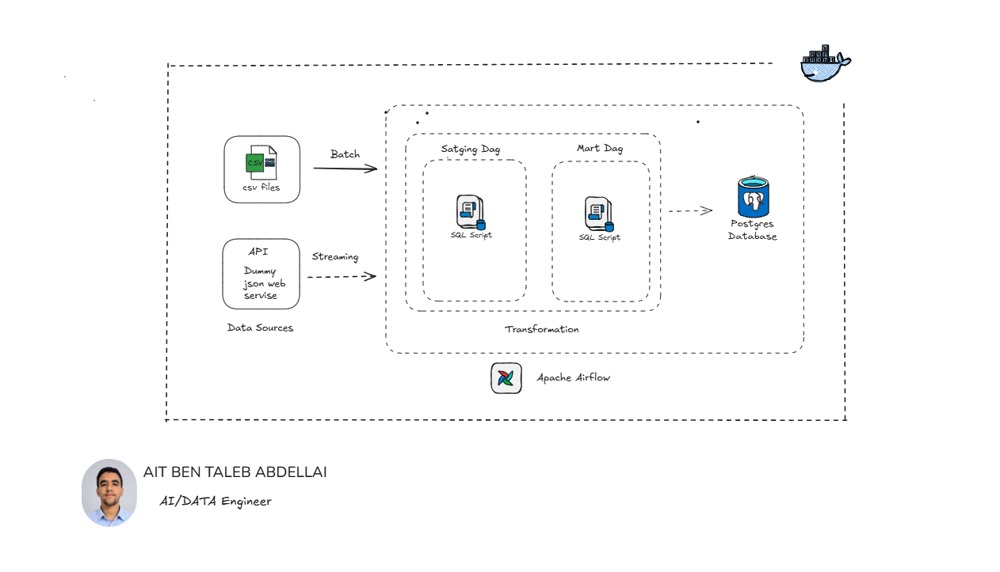

# BIM Pipelines — Data Ingestion & Processing Architecture

An end-to-end data pipeline orchestration project built with **Apache Airflow, PostgreSQL, Adminer, and Docker Compose**. The platform demonstrates how to ingest data from multiple sources, orchestrate processing workflows, transform raw datasets, and prepare analytical data marts for downstream business intelligence.

## 📌 Project Overview

The project implements a modular data pipeline architecture organized into four stages:

- **1. Streaming Ingestion:** Continuously ingests checkout events from streaming API payloads.
- **2. Batch Ingestion:** Runs scheduled daily ingestion workflows (`@daily`) for reference data, including stores, products, and promotions.
- **3. Staging Layer:** Waits for upstream ingestion tasks to complete, cleans and normalizes raw data, and executes SQL transformation scripts.
- **4. Data Marts:** Builds analytical data marts after successful staging execution, preparing structured datasets for reporting and business intelligence.

The architecture separates ingestion, transformation, and analytical processing into independent workflows, improving modularity, maintainability, and orchestration.

## 🏗️ Platform Architecture



### Data Flow

**1. Data Ingestion**

Data enters the platform through two ingestion paths:

- **Streaming:** Checkout events are ingested from API payloads.
- **Batch:** CSV files provide reference data such as stores, products, and promotions.

**2. Workflow Orchestration**

Apache Airflow coordinates pipeline execution through Directed Acyclic Graphs (DAGs). It manages task dependencies, schedules batch jobs, and controls the execution order of downstream transformations.

**3. Data Storage**

PostgreSQL serves as the central relational database, consolidating ingested data and storing the results of transformation workflows in the `bim` database.

**4. Data Transformation**

SQL scripts clean, normalize, and transform data in the staging layer before preparing analytical tables in the data marts layer.

**5. Database Management**

Adminer provides a lightweight web interface for inspecting and managing the PostgreSQL database.

## 🛠️ Tech Stack

| Component | Technology | Purpose |
|---|---|---|
| Orchestration | Apache Airflow 2.9.3 | DAG scheduling and workflow dependencies |
| Database | PostgreSQL 15 | Relational data storage |
| Database UI | Adminer | Database inspection and management |
| Containerization | Docker | Isolated service environments |
| Service Orchestration | Docker Compose | Multi-container deployment |
| Programming | Python | Ingestion and pipeline task logic |
| Transformations | SQL | Data cleansing, normalization, and aggregation |


## 🚀 Getting Started

### Prerequisites

Make sure you have the following installed:

- Docker Desktop
- Docker Compose (included with current Docker Desktop installations)
- Git

Ensure Docker Desktop is running before starting the project.

### 1. Clone the Repository

```bash
git clone https://github.com/abdelali-1111/BIM_Pipelines.git
cd BIM_Pipelines
```

### 2. Start the Services

Build and launch the containers in detached mode:

```bash
docker compose up -d
```

Check the status of the running services:

```bash
docker compose ps
```

### 3. Access Apache Airflow

Open the Airflow web interface:

**URL:** http://localhost:8081

**Username:** `admin`

To retrieve the automatically generated standalone administrator password, run:

```bash
docker compose exec airflow cat /opt/airflow/standalone_admin_password.txt
```

Once logged in, inspect the available DAGs and their execution status.

**Expected initial state:** The `1_streaming` and `2_batch` workflows are intended to handle ingestion, while `3_staging` and `4_marts` are prepared for downstream transformation tasks. Actual execution depends on the DAG definitions, task configuration, and available input data.

### 4. Access Adminer

Open the database management interface:

**URL:** http://localhost:8085

Use the following connection settings:

| Setting | Value |
|---|---|
| System | PostgreSQL |
| Server | `postgres` |
| Username | `bim` |
| Password | `bim` |
| Database | `bim` |

> **Note:** These credentials are suitable for a local demonstration environment. Use secure credentials and appropriate secret management before deploying the project to a shared or production environment.

## 🗂️ Project Structure

```text
BIM_Pipelines/
├── dags/
│   ├── 1_streaming_dag.py
│   ├── 2_batch_dag.py
│   ├── 3_staging_dag.py
│   └── 4_marts_dag.py
├── sql/
│   ├── staging/
│   │   └── # Staging transformation scripts
│   └── mart/
│       └── # Analytical data mart scripts
├── assets/
│   ├── airflow_dags.png
│   └── architecture.png
├── docker-compose.yml
├── .gitignore
└── README.md
```

## 🎯 Key Learning Objectives

This project demonstrates practical data engineering concepts:

- Designing modular ETL/ELT pipeline architectures.
- Implementing batch and event-oriented ingestion workflows.
- Orchestrating dependent workflows with Apache Airflow.
- Separating raw data ingestion from staging transformations and analytical data marts.
- Using SQL for data cleansing, normalization, and aggregation.
- Managing relational data with PostgreSQL.
- Containerizing data infrastructure with Docker Compose.

## 🔮 Potential Improvements

Future enhancements could include:

- Implementing automated data quality checks and validation.
- Adding retries, failure notifications, and pipeline monitoring.
- Introducing incremental loading and idempotent processing.
- Integrating a BI platform such as Power BI or Apache Superset.
- Adding automated testing and CI/CD workflows.
- Strengthening credential management and environment configuration.

## 👤 Author

**Abdelali**

GitHub: [@abdelali-1111](https://github.com/abdelali-1111)

